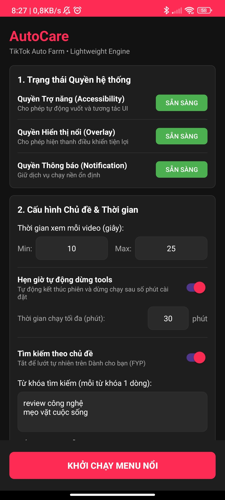
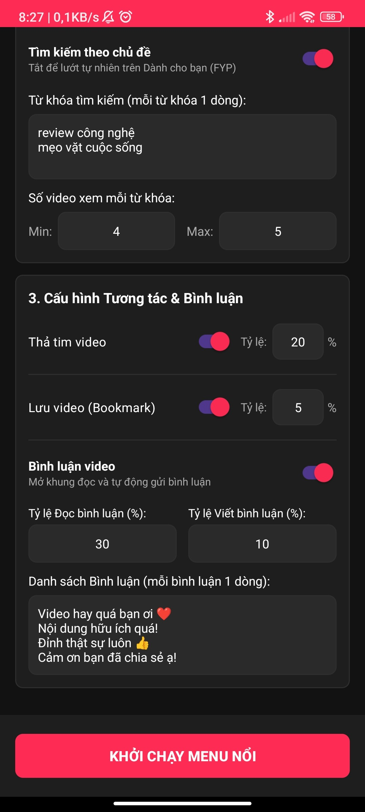
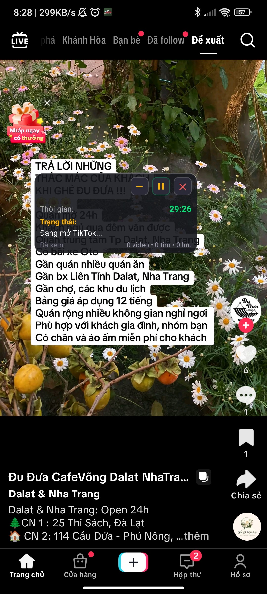

# AutoCare - Ứng dụng Tự động hóa Nuôi nick & Tương tác TikTok trên Android

<p align="center">
  <br>
  <b>Hệ thống Tự động hóa Nuôi nick & Tương tác TikTok Tự nhiên</b><br>
  <i>Chạy Native độc lập 100% trên Android • Không cần máy tính • Không Root</i>
</p>

<p align="center">
  <a href="https://developer.android.com"></a>
  <a href="https://kotlinlang.org"></a>
  <a href="https://gradle.org"></a>
  <a href="LICENSE"></a>
</p>

---

## 📸 Ảnh chụp Giao diện Thực tế (Screenshots)

<table align="center">
  <tr>
    <th align="center">1. Cấu hình Quyền & Chủ đề</th>
    <th align="center">2. Cấu hình Tương tác & Spintax</th>
    <th align="center">3. Hoạt động Thực tế trên TikTok</th>
  </tr>
  <tr>
    <td align="center" valign="top">
      
    </td>
    <td align="center" valign="top">
      
    </td>
    <td align="center" valign="top">
      
    </td>
  </tr>
</table>

---

## Mục lục

- [1. Tính năng nổi bật](#1-tính-năng-nổi-bật)
- [2. Cơ chế Chống quét & Giả lập Người thật (Anti-Detect)](#2-cơ-chế-chống-quét--giả-lập-người-thật-anti-detect)
- [3. Thông số cấu hình mặc định](#3-thông-số-cấu-hình-mặc-định)
- [4. Hướng dẫn cài đặt & Sử dụng](#4-hướng-dẫn-cài-đặt--sử-dụng)
  - [Cách 1: Cài đặt trực tiếp qua file APK](#cách-1-cài-đặt-trực-tiếp-qua-file-apk)
  - [Cách 2: Tự biên dịch từ mã nguồn](#cách-2-tự-biên-dịch-từ-mã-nguồn)
  - [Hướng dẫn thiết lập quyền & khởi chạy](#hướng-dẫn-thiết-lập-quyền--khởi-chạy)
- [5. Cấu trúc thư mục mã nguồn](#5-cấu-trúc-thư-mục-mã-nguồn)
- [6. Tài liệu kỹ thuật chi tiết](#6-tài-liệu-kỹ-thuật-chi-tiết)
- [7. Tuyên bố miễn trừ trách nhiệm (Disclaimer)](#7-tuyên-bố-miễn-trừ-trách-nhiệm-disclaimer)

---

## 1. Tính năng nổi bật

- **Tự động lướt & tương tác tự nhiên:**
  - Tự động xem video theo khoảng thời gian ngẫu nhiên (mặc định 10 – 25 giây).
  - Tự động thả tim, lưu video vào mục Yêu thích (*Bookmark*), mở bảng bình luận lướt đọc và đăng bình luận theo tỷ lệ tùy chỉnh.
- **Tìm kiếm chủ đề thông minh (Seeding đề xuất):**
  - Tự động chọn ngẫu nhiên một từ khóa trong danh sách chủ đề do người dùng thiết lập.
  - Tự động tìm kiếm, lướt xem 4–5 video theo chủ đề để "mớm" thuật toán gợi ý của TikTok, sau đó tự động quay về Trang chủ tiếp tục tương tác.
- **Hệ thống Spintax chống spam bình luận:**
  - Tự động chọn ngẫu nhiên câu bình luận và giải mã cú pháp Spintax lồng nhau dạng `{Video hay|Nội dung tuyệt vời} {quá bạn ơi|ạ}! ❤️`.
  - Hàng trăm lượt bình luận liên tiếp đều là các biến thể khác nhau, chống bị kiểm duyệt spam.
- **Bảng điều khiển nổi thông minh (Floating Overlay Widget):**
  - Widget thu nhỏ tinh tế (rộng 235dp), kéo thả tự do trên màn hình mọi lúc mọi nơi.
  - Hiển thị đồng hồ đếm ngược hẹn giờ tự động.
  - Cập nhật dòng trạng thái hành động theo thời gian thực (Đang xem, Thả tim, Đọc cmt, Bỏ qua quảng cáo...).
  - Thống kê chi tiết realtime: `X video • Y tim • Z lưu`.
- **Hẹn giờ dừng tự động:**
  - Cài đặt thời lượng tối đa cho mỗi phiên chạy (mặc định 30 phút), tự động dừng kịch bản an toàn khi hoàn thành.

---

## 2. Cơ chế Chống quét & Giả lập Người thật (Anti-Detect)

Để bảo vệ tài khoản không bị đánh dấu bất thường (*Shadowban*), AutoCare xây dựng các lớp giả lập hành vi sinh học:

1. **Quỹ đạo vuốt cong Bezier:**
   - Mọi thao tác cuộn lướt video đều sử dụng đường cong Bezier (`Path.quadTo`) với điểm uốn ngẫu nhiên lệch $\pm 40\text{px}$ và thời gian vuốt biến thiên ngẫu nhiên, loại bỏ hoàn toàn các đường vuốt thẳng đứng máy móc.
2. **Độ trễ ngẫu nhiên có phân phối Gaussian:**
   - Khoảng nghỉ giữa các bước tương tác tuân theo hàm phân phối chuẩn Gaussian, tập trung quanh giá trị trung bình $\mu$ mô phỏng phản xạ sinh học của người thật.
3. **Tự động nhận diện & bỏ qua nội dung rác:**
   - Quét và phát hiện chính xác các video **Quảng cáo** (nhãn Sponsored, nút CTA tải ứng dụng, truy cập website) và phòng **Livestream** để lập tức vuốt bỏ qua mà không tương tác.
4. **Bộ ngắt mạch an toàn (Circuit Breaker):**
   - Nếu bị kẹt bỏ qua liên tiếp quá 4 lần, hoặc vô tình bấm lạc vào trang cá nhân hay trang trưng bày TikTok Shop, hệ thống sẽ tự động kích hoạt chu trình thoát và đưa màn hình trở về lại **Trang chủ** an toàn.
5. **Thao tác chạm vật lý chính xác:**
   - Gửi cử chỉ chạm tọa độ (`dispatchGesture`) trực tiếp lên các nút tương tác bên phải màn hình để tránh việc bị TikTok chặn sự kiện trợ năng ảo (`ACTION_CLICK`).

---

## 3. Thông số cấu hình mặc định

Khi cài đặt mới hoặc cập nhật ứng dụng, hệ thống tự động áp dụng các thông số cân bằng tối ưu:

| Thông số | Mặc định | Ý nghĩa chức năng |
| :--- | :---: | :--- |
| **Hẹn giờ dừng tool** | **30 phút** | Tự động ngắt kịch bản sau 30 phút hoạt động |
| **Thời gian xem mỗi video** | **10 – 25 giây** | Random thời gian xem mỗi video trên feed |
| **Tìm kiếm theo chủ đề** | **Bật (ON)** | Tìm kiếm 1 chủ đề ngẫu nhiên trước khi về feed chính |
| **Số video xem chủ đề** | **4 – 5 video** | Xem lướt để định hình thuật toán đề xuất |
| **Tỷ lệ Thả tim** | **20%** | Trung bình 5 video thả tim 1 lần |
| **Tỷ lệ Lưu video** | **5%** | Trung bình 20 video lưu vào Yêu thích 1 lần |
| **Tỷ lệ Đọc bình luận** | **30%** | Mở bảng bình luận và cuộn đọc 1–3 lần |
| **Tỷ lệ Viết bình luận** | **10%** | Chỉ kích hoạt khi bảng bình luận đang mở |
| **Chọn từ khóa & bình luận** | **Ngẫu nhiên (Random)** | Tránh lặp lại dòng đầu tiên |

---

## 4. Hướng dẫn cài đặt & Sử dụng

### Cách 1: Cài đặt trực tiếp qua file APK
1. Tải file APK phiên bản mới nhất từ thư mục: [app/build/outputs/apk/debug/app-debug.apk](app/build/outputs/apk/debug/app-debug.apk) (hoặc mục **Releases** của GitHub).
2. Chuyển file APK vào điện thoại Android và tiến hành cài đặt.
3. Cho phép quyền cài đặt ứng dụng từ nguồn không xác định (*Unknown sources*) nếu được hệ điều hành yêu cầu.

### Cách 2: Tự biên dịch từ mã nguồn
Yêu cầu: Đã cài đặt **JDK 21** và **Android SDK** (API 34).

```bash
# Clone dự án về máy
git clone https://github.com/vcgiang09h/TiktokAutoCare.git
cd TiktokAutoCare

# Chạy Unit Tests kiểm tra tính toàn vẹn
./gradlew testDebugUnitTest

# Biên dịch gói APK Debug
./gradlew assembleDebug
```
File APK hoàn tất sẽ được tạo tại đường dẫn: `app/build/outputs/apk/debug/app-debug.apk`.

### Hướng dẫn thiết lập quyền & khởi chạy
1. **Mở ứng dụng AutoCare:**
   - Tại thẻ **Trạng thái quyền hệ thống**:
     - Bấm **Bật Trợ năng**: Chọn **AutoCare** trong danh sách Trợ năng của máy và bật công tắc Cho phép.
     - Bấm **Cấp quyền hiển thị nổi**: Cho phép AutoCare hiển thị trên các ứng dụng khác.
     - *(Tùy chọn)* Cấp quyền Thông báo trên Android 13+.
2. **Cài đặt thông số (Tùy chọn):**
   - Nhập các từ khóa chủ đề mong muốn (mỗi dòng 1 từ khóa).
   - Nhập các câu bình luận Spintax (mỗi dòng 1 mẫu).
   - Điều chỉnh tỷ lệ tương tác theo nhu cầu hoặc giữ nguyên mặc định tối ưu.
3. **Bắt đầu tự động hóa:**
   - Bấm nút **"KHỞI CHẠY MENU NỔI"** ở đáy màn hình chính.
   - Mở ứng dụng **TikTok** (hỗ trợ cả bản Việt Nam `com.ss.android.ugc.trill` và bản Quốc tế `com.zhiliaoapp.musically`).
   - Bấm nút **Play (▶)** trên bảng điều khiển nổi để bắt đầu chạy kịch bản tự động.
   - Bấm nút **Tạm dừng (❚❚)** hoặc nút **Đóng (✕)** trên thanh nổi bất cứ lúc nào bạn muốn.

---

## 5. Cấu trúc thư mục mã nguồn

```text
AutoCare/
├── app/
│   ├── build.gradle.kts                         # Cấu hình SDK, dependencies & Android Gradle Plugin
│   └── src/main/
│       ├── AndroidManifest.xml                  # Khai báo Accessibility, Overlay & Permissions
│       ├── res/
│       │   ├── layout/
│       │   │   ├── activity_main.xml            # Giao diện cấu hình 1 màn hình cuộn 4 thẻ
│       │   │   └── layout_floating_widget.xml   # Giao diện Widget nổi 235dp
│       │   └── xml/
│       │       └── accessibility_config.xml     # Cấu hình cờ cử chỉ & đọc cửa sổ tương tác
│       └── java/giangvc/cntt/ntu/autocare/
│           ├── AutoCareApp.kt                   # Lớp Application khởi tạo tài nguyên
│           ├── MainActivity.kt                  # UI cấu hình, lưu SharedPreferences v3, kiểm tra quyền
│           ├── model/
│           │   └── FarmConfig.kt                # Data class cấu hình & migration phiên bản tự động
│           ├── engine/
│           │   ├── AutomationStateManager.kt    # StateFlow Bus điều phối tập trung giữa UI và Service
│           │   ├── GestureHelper.kt             # Bộ phát cử chỉ Bezier cong & dispatch tap vật lý
│           │   ├── NodeFinder.kt                # Bộ lọc nhận diện UI TikTok, lọc Ad, Live, khóa Home tab
│           │   └── SpintaxParser.kt             # Bộ giải mã Spintax bình luận ngẫu nhiên
│           └── service/
│               ├── FloatingControlService.kt    # WindowManager quản lý cửa sổ nổi, timer & kéo thả
│               └── TikTokAutoService.kt         # AccessibilityService thực thi State Machine 8 bước
├── docs/
│   ├── assets/                                  # Tài nguyên hình ảnh tài liệu & ảnh chụp giao diện
│   │   ├── app_icon.png
│   │   ├── ui_screen_1.jpg
│   │   ├── ui_screen_2.jpg
│   │   └── ui_screen_3.jpg
│   └── tiktok_auto_farm_spec.md                 # Tài liệu đặc tả kỹ thuật kiến trúc chuyên sâu
└── README.md                                    # Hướng dẫn tổng quan & cài đặt dự án
```

---

## 6. Tài liệu kỹ thuật chi tiết

Để tìm hiểu sâu hơn về kiến trúc hệ thống, bảng chuyển trạng thái (*State Transition Table*), thuật toán giải mã Spintax và kỹ thuật lọc phần tử UI chống thay đổi ViewID, vui lòng tham khảo:
👉 **[Tài liệu Đặc tả Kỹ thuật & Kiến trúc Hệ thống (docs/tiktok_auto_farm_spec.md)](./docs/tiktok_auto_farm_spec.md)**

---

## 7. Tuyên bố miễn trừ trách nhiệm (Disclaimer)

- Dự án này được phát triển với mục đích **nghiên cứu kỹ thuật**, học tập công nghệ phát triển ứng dụng Android Native, nghiên cứu dịch vụ Trợ năng (*Android Accessibility Service*) và tương tác đồ họa giao diện nổi (*WindowManager Overlay*).
- Tác giả không chịu trách nhiệm đối với bất kỳ hành vi lạm dụng, vi phạm Điều khoản Dịch vụ của bên thứ ba, hoặc sự cố phát sinh trên tài khoản của người dùng. Hãy sử dụng một cách hợp lý và có trách nhiệm!
