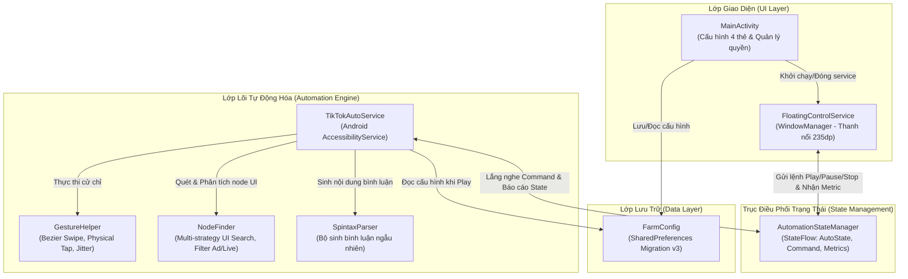
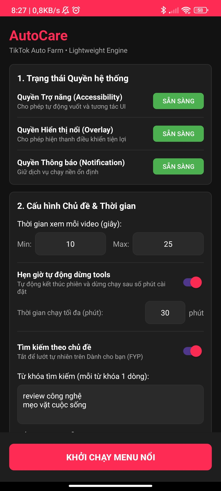
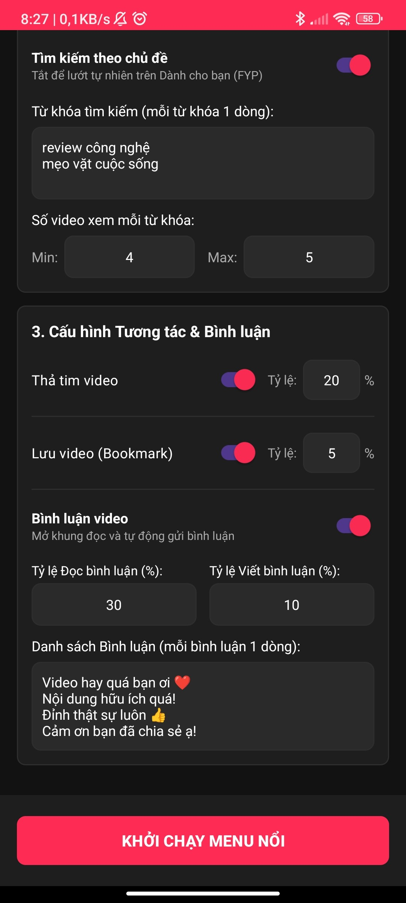
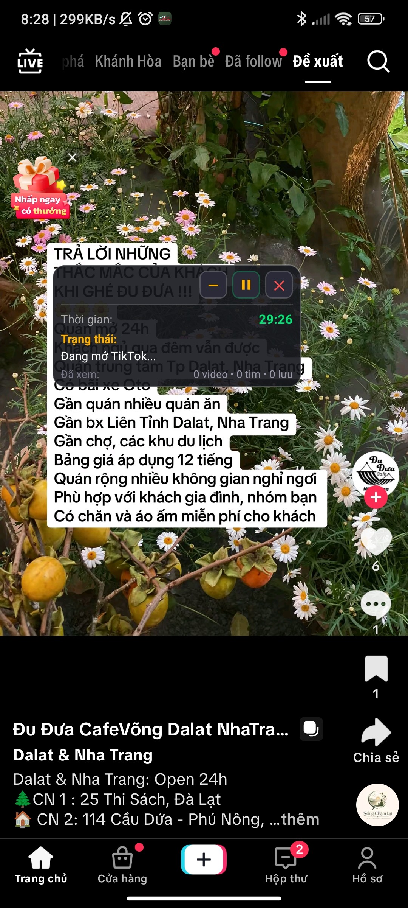
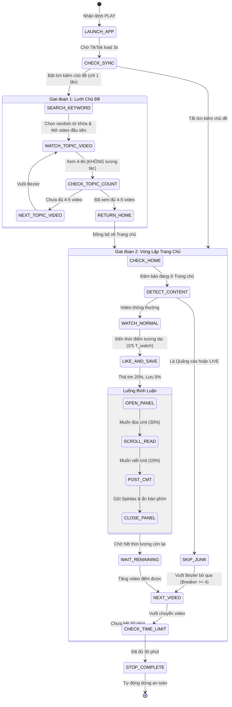

# TÀI LIỆU ĐẶC TẢ KỸ THUẬT & KIẾN TRÚC HỆ THỐNG AUTOCARE (TIKTOK AUTO FARM)

> **Dự án:** AutoCare - Hệ thống tự động hóa nuôi nick & tương tác TikTok trên thiết bị di động Android  
> **Phiên bản tài liệu:** 3.0 (Đồng bộ toàn diện với mã nguồn thực tế)  
> **Package Name:** `giangvc.cntt.ntu.autocare`  
> **Nền tảng:** Android Native (100% Kotlin)  

---

## 1. Tổng quan Dự án & Mục tiêu Thiết kế

### 1.1. Mục tiêu sản phẩm
AutoCare là ứng dụng Android hoạt động **hoàn toàn độc lập trên thiết bị di động**, không yêu cầu kết nối máy tính qua ADB, không cần can thiệp Root máy. Ứng dụng mô phỏng chính xác 100% hành vi người dùng thật để lướt video, nuôi tài khoản (seeding), định hình thuật toán đề xuất (*For You Page - FYP*) và tăng tương tác (thả tim, lưu video, đọc & viết bình luận) trên nền tảng TikTok.

### 1.2. Các trụ cột thiết kế chính
1. **Hoạt động độc lập & Bền bỉ:** Tích hợp `AccessibilityService` kết hợp `WindowManager` vẽ giao diện nổi (*Floating Overlay*) cho phép người dùng điều khiển trực tiếp trên nền ứng dụng TikTok.
2. **Siêu nhẹ & Tiết kiệm tài nguyên:** Sử dụng XML Layout truyền thống, không dùng Jetpack Compose hay thư viện hoạt họa nặng, giữ dung lượng bộ cài $\approx 7.4\text{ MB}$, hạn chế tối đa tiêu thụ RAM và pin khi chạy ngầm dài giờ.
3. **Chống quét toàn diện (Anti-Detect First):** Không dùng các lệnh gọi sự kiện giả lập có thể bị nhận diện (như `ACTION_CLICK` ảo). Mọi thao tác đều được chuyển hóa thành cử chỉ chạm vật lý (`dispatchGesture`) với đường cong Bezier và độ trễ ngẫu nhiên phân phối chuẩn Gaussian.
4. **Tự phục hồi thông minh (Self-Healing / Circuit Breaker):** Hệ thống có khả năng nhận diện các màn hình bất thường (Quảng cáo, Livestream, Trang cá nhân, Trang trưng bày TikTok Shop, kết quả tìm kiếm) để tự động thoát và hồi phục về luồng xem chính.

---

## 2. Công nghệ & Kiến trúc Hệ thống (Tech Stack & Architecture)



### 2.1. Chi tiết Tech Stack
- **Ngôn ngữ:** Kotlin 100% (target JVM 21, Android Gradle Plugin 8.9+, Gradle 9.2+).
- **Hệ điều hành tương thích:** Android 7.0 (API 24) đến Android 14+ (API 34).
- **Kiến trúc luồng:** Kotlin Coroutines (`SupervisorJob`, `Dispatchers.Default`, `Dispatchers.Main`) + `StateFlow` reactive stream.
- **Dịch vụ nền:**
  - `TikTokAutoService` kế thừa `AccessibilityService` (quyền `BIND_ACCESSIBILITY_SERVICE`).
  - `FloatingControlService` kế thừa `Service` (quyền `SYSTEM_ALERT_WINDOW`, `FOREGROUND_SERVICE_SPECIAL_USE`).
- **Giao tiếp liên dịch vụ:** Cơ chế State Management tập trung qua [AutomationStateManager.kt](../app/src/main/java/giangvc/cntt/ntu/autocare/engine/AutomationStateManager.kt) — không phụ thuộc `BroadcastReceiver` nhằm giảm tải độ trễ hệ thống.

---

## 3. Thiết kế Giao diện Người dùng (UI/UX Specification)

<table align="center">
  <tr>
    <th align="center">1. Cấu hình Quyền & Chủ đề</th>
    <th align="center">2. Cấu hình Tương tác & Spintax</th>
    <th align="center">3. Hoạt động Thực tế trên TikTok</th>
  </tr>
  <tr>
    <td align="center" valign="top">
      
    </td>
    <td align="center" valign="top">
      
    </td>
    <td align="center" valign="top">
      
    </td>
  </tr>
</table>

### 3.1. Màn hình Cấu hình Chính (`MainActivity`)
Thiết kế theo dạng cuộn 1 màn hình (*Single ScrollView*) chia thành 4 thẻ chức năng bo góc phẳng:

1. **Thẻ 1: Trạng thái Quyền hệ thống (`CardView` Permissions)**
   - Nút bật/kiểm tra **Quyền Trợ năng** (*Accessibility Service*): Đổi màu nền Xanh khi đã sẵn sàng, Đỏ khi chưa cấp.
   - Nút bật/kiểm tra **Quyền Hiển thị nổi** (*Draw over other apps*): Chuyển trạng thái tức thời.
   - Nút cấp **Quyền Thông báo** (*POST_NOTIFICATIONS* trên Android 13+).
2. **Thẻ 2: Cấu hình Chủ đề & Thời gian xem**
   - Công tắc Bật/Tắt tìm kiếm theo chủ đề (`switchSearchByKeyword`).
   - Danh sách từ khóa tìm kiếm (`EditText` nhiều dòng): Nhập mỗi từ khóa 1 dòng. Hệ thống sẽ **chọn ngẫu nhiên (random)** 1 từ khóa cho mỗi phiên khởi động.
   - Thời gian xem video mỗi giây: 2 ô số `Min [ 10 ]` - `Max [ 25 ]`.
   - Số video xem theo chủ đề: 2 ô số `Min [ 4 ]` - `Max [ 5 ]`.
   - Công tắc Bật/Tắt hẹn giờ dừng tool kèm ô nhập `[ 30 ]` phút.
3. **Thẻ 3: Cấu hình Tương tác & Bình luận**
   - Công tắc & Tỷ lệ Thả tim (`likeRate`): `[ 20 ] %`.
   - Công tắc & Tỷ lệ Lưu video / Bookmark (`saveRate`): `[ 5 ] %`.
   - Công tắc Bật/Tắt Bình luận:
     - Tỷ lệ Đọc bình luận (`readCommentRate`): `[ 30 ] %`.
     - Tỷ lệ Viết bình luận (`writeCommentRate`): `[ 10 ] %` (chỉ chạy khi khung cmt đang mở).
     - Từ điển mẫu bình luận Spintax (`EditText` nhiều dòng): Chọn ngẫu nhiên câu và sinh biến thể tự động.
4. **Thẻ 4: Nút Hành động Cố định (Action Button)**
   - Nút lớn toàn chiều rộng: **"KHỞI CHẠY MENU NỔI"** (hoặc **"ĐÓNG MENU NỔI"** khi đang chạy).

### 3.2. Bảng Điều khiển Nổi (`FloatingControlService` - WindowManager)
- **Kích thước & Thiết kế:** Độ rộng mở rộng chuẩn **$235\text{ dp}$** (tối đa $65\%$ chiều ngang màn hình), chiều cao tự co giãn theo nội dung, nền đen trong suốt (`#CC000000`), viền bo tròn $14\text{ dp}$.
- **Cơ chế Kéo thả:** Nhận diện sự kiện `ACTION_DOWN`, `ACTION_MOVE`, `ACTION_UP` có phân biệt giữa thao tác click và kéo thả (ngưỡng dịch chuyển $> 10\text{ px}$).
- **Cấu trúc hiển thị 3 hàng:**
  - **Hàng 1 (Header):**
    - Nhãn thời gian đếm ngược: `Thời gian: 29:45` (màu xanh lá tươi sáng khi chạy, chuyển vàng khi tạm dừng).
    - Bộ 3 nút điều khiển tối giản: Thu nhỏ (`—`), Play/Pause (▶ / ❚❚), Đóng hẳn (`✕`).
  - **Hàng 2 (Status):**
    - `Trạng thái: Đang xem video... (18s) • Trang chủ` (chữ vàng cam nổi bật, cập nhật trực tiếp theo từng bước xử lý).
  - **Hàng 3 (Metrics):**
    - `Đã xem: 4 video • 1 tim • 0 lưu` (chữ xám bạc, hiển thị đầy đủ trên 1 dòng, không xuống dòng).

---

## 4. Quản lý Cấu hình & Dữ liệu (FarmConfig & Migration)

Toàn bộ thông số hoạt động được mô hình hóa trong [FarmConfig.kt](../app/src/main/java/giangvc/cntt/ntu/autocare/model/FarmConfig.kt) và lưu trữ cục bộ qua `SharedPreferences` (`autocare_config`).

### 4.1. Bảng Thông số Cấu hình Mặc định (Phiên bản v3)

| Thuộc tính mã nguồn | Khóa SharedPreferences | Mặc định | Ý nghĩa chức năng |
| :--- | :--- | :---: | :--- |
| `enableSearchByKeyword` | `enable_search` | `true` | Bật tìm kiếm 1 chủ đề trước khi về Home |
| `keywords` | `keywords` | Review công nghệ, mẹo vặt... | Danh sách từ khóa (chọn ngẫu nhiên) |
| `watchTimeMinSec` | `watch_time_min` | `10` | Thời gian xem tối thiểu mỗi video (giây) |
| `watchTimeMaxSec` | `watch_time_max` | `25` | Thời gian xem tối đa mỗi video (giây) |
| `videosPerKeywordMin` | `videos_per_kw_min` | `4` | Số video tối thiểu xem theo chủ đề |
| `videosPerKeywordMax` | `videos_per_kw_max` | `5` | Số video tối đa xem theo chủ đề |
| `enableTimeLimit` | `enable_time_limit` | `true` | Bật giới hạn thời gian chạy kịch bản |
| `timeLimitMinutes` | `time_limit_minutes` | `30` | Tự động dừng sau 30 phút |
| `enableLike` | `enable_like` | `true` | Cho phép thả tim video |
| `likeRate` | `like_rate` | `20` | Tỷ lệ thả tim ($20\% \approx 1/5$ video) |
| `enableSave` | `enable_save` | `true` | Cho phép lưu video vào mục Yêu thích |
| `saveRate` | `save_rate` | `5` | Tỷ lệ lưu video ($5\% \approx 1/20$ video) |
| `enableComment` | `enable_comment` | `true` | Cho phép mở đọc & viết bình luận |
| `readCommentRate` | `read_comment_rate` | `30` | Tỷ lệ mở khung bình luận ($30\%$) |
| `writeCommentRate` | `write_comment_rate` | `10` | Tỷ lệ viết bình luận ($10\%$) |
| `commentDictionary` | `comment_dictionary` | 4 mẫu câu Spintax | Danh sách câu bình luận (chọn ngẫu nhiên) |

### 4.2. Cơ chế Version Migration tự động
Để đảm bảo khi người dùng cập nhật ứng dụng từ các phiên bản cũ không bị giữ lại các giá trị cấu hình lỗi thời:
```kotlin
val currentVer = prefs.getInt(KEY_CONFIG_VERSION, 0)
if (currentVer < CURRENT_CONFIG_VERSION) {
    // Tự động nâng cấp thông số mặc định mới (30p, 10-25s, tim 20%, lưu 5%, cmt 30/10)
    // Giữ nguyên từ khóa và câu bình luận riêng mà người dùng đã soạn
    saveToPrefs(context, migratedConfig)
}
```

---

## 5. Đặc tả Máy Trạng Thái Cốt Lõi (Core State Machine)

Toàn bộ quy trình tự động được điều phối bởi Coroutine trong [TikTokAutoService.kt](../app/src/main/java/giangvc/cntt/ntu/autocare/service/TikTokAutoService.kt) qua vòng lặp State Machine 2 giai đoạn:



### 5.1. Giai đoạn 1: Tìm kiếm chủ đề Seeding (Chạy 1 lần duy nhất)
1. **Lấy từ khóa ngẫu nhiên:** Gọi `config.keywords.filter { it.isNotBlank() }.random()` để chọn ngẫu nhiên 1 chủ đề.
2. **Tìm kiếm an toàn:**
   - Click nút Search hoặc tap tọa độ đỉnh phải màn hình.
   - Điền từ khóa qua `ACTION_SET_TEXT`.
   - Submit tìm kiếm ưu tiên: (1) Nút tìm kiếm đỏ góc trên phải; (2) Dòng gợi ý đầu tiên; (3) Gửi sự kiện `ACTION_IME_ENTER`.
   - Chuyển sang tab **Video** và bấm vào video thumbnail đầu tiên (ở cột 1, loại trừ hoàn toàn banner hồ sơ kênh).
3. **Quy tắc vàng khi lướt chủ đề:**
   - Chỉ xem lướt từ $4\text{s} - 8\text{s}$ cho mỗi video trong số $4 - 5$ video chủ đề.
   - **Tuyệt đối không thả tim, lưu video hay bình luận** trong luồng tìm kiếm để tránh hành vi bất thường.
4. **Hồi quy Trang chủ:** Sau khi kết thúc $4 - 5$ video chủ đề, hàm `stepBackToHomeScreen()` được gọi để đưa TikTok về lại Home feed chính.

### 5.2. Giai đoạn 2: Vòng lặp Trang chủ (Home Feed Loop)
Vòng lặp bất tận lướt video trên trang "Dành cho bạn" (*For You*) cho đến khi hết giờ hoặc người dùng bấm Pause/Stop:
1. **Kiểm tra Trang chủ (`isAtHomeScreen`):**
   - Kiểm tra tab "Đề xuất" / "Dành cho bạn" trên đỉnh màn hình hoặc tab "Trang chủ" ở đáy đang được chọn.
   - Nếu chưa ở Trang chủ $\rightarrow$ Lập tức gọi `stepBackToHomeScreen()`.
2. **Lọc nội dung rác (`NodeFinder.detectAdOrLive`):**
   - Nếu là Quảng cáo hoặc Livestream $\rightarrow$ Cập nhật thông báo lên widget nổi và vuốt bỏ qua ngay sau $0.8\text{s} - 1.2\text{s}$.
   - Nếu liên tục bỏ qua $\ge 4$ lần liên tiếp $\rightarrow$ Kích hoạt bộ ngắt mạch (*Circuit Breaker*), đồng bộ lại Trang chủ để chống kẹt phòng LIVE.
3. **Xem & Tương tác video thông thường (`processSingleVideo`):**
   - Sinh thời lượng xem $T_{watch} \in [10, 25]\text{ giây}$ theo phân phối ngẫu nhiên.
   - Chờ đến thời điểm vàng (ở khoảng $40\%$ thời lượng xem) để tiến hành tương tác:
     - Thả tim ($20\%$): Chạm vật lý trực tiếp lên nút Tim ở cột phải; fallback double-tap giữa màn hình.
     - Lưu video ($5\%$): Chạm vật lý lên nút Bookmark ở cột phải.
     - Đọc bình luận ($30\%$): Chạm nút bình luận ở cột phải $\rightarrow$ Ẩn bàn phím ảo nếu bật nhầm $\rightarrow$ Vuốt cuộn đọc $1 - 3$ lần ngẫu nhiên.
     - Viết bình luận ($10\%$): Lấy câu ngẫu nhiên từ `SpintaxParser` $\rightarrow$ Điền vào ô nhập $\rightarrow$ Bấm nút Gửi $\rightarrow$ Đóng bảng bình luận.
   - Chờ hết khoảng thời gian còn lại của video.
   - Vuốt Bezier chuyển sang video tiếp theo.
4. **Kiểm tra Hẹn giờ:** Kiểm tra `isTimeLimitExceeded()` (mặc định 30 phút). Khi đủ thời gian, tự động gửi lệnh `Command.STOP`, dừng coroutine an toàn và thông báo lên thanh trạng thái.

---

## 6. Động cơ Anti-Detect & Giả lập Hành vi Người thật

### 6.1. Cử chỉ Vuốt cong Bezier ngẫu nhiên (`GestureHelper`)
Không bao giờ sử dụng đường vuốt thẳng đứng $X_1 = X_2$ vì máy chủ TikTok dễ dàng nhận diện cử chỉ cơ học:
```kotlin
val path = Path()
path.moveTo(startX, startY)
// Điểm điều khiển Bezier lệch ngẫu nhiên sang trái hoặc phải ±40px
val controlX = (startX + endX) / 2f + rng.nextFloat(-40f, 40f)
val controlY = (startY + endY) / 2f + rng.nextFloat(-30f, 30f)
path.quadTo(controlX, controlY, endX, endY)
```
Thời gian vuốt được tính toán ngẫu nhiên từ $280\text{ms} - 450\text{ms}$.

### 6.2. Phân phối Độ trễ chuẩn Gaussian (Gaussian Jitter)
Mọi thời gian chờ giữa các thao tác (chờ xem, chờ bấm, chờ tải trang) đều tuân theo hàm phân phối chuẩn với $99.7\%$ giá trị tập trung quanh giá trị trung bình $\mu$:
$$\mu = \frac{\text{min} + \text{max}}{2}, \quad \sigma = \frac{\text{max} - \text{min}}{6}$$
```kotlin
private fun randomDelay(minMs: Long, maxMs: Long): Long {
    val mean = (minMs + maxMs) / 2.0
    val stdDev = (maxMs - minMs) / 6.0
    val sample = (Random().nextGaussian() * stdDev + mean).toLong()
    return sample.coerceIn(minMs, maxMs)
}
```

### 6.3. Tương tác Chạm vật lý (`dispatchGesture`)
TikTok áp dụng cơ chế chặn sự kiện Accessibility ảo (`AccessibilityNodeInfo.ACTION_CLICK`) trên các nút tương tác nhạy cảm (nút Tim, nút Lưu, nút Comment). AutoCare giải quyết triệt để bằng cách:
1. Đọc tọa độ hiển thị thực tế của phần tử trên màn hình: `node.getBoundsInScreen(bounds)`.
2. Tạo điểm chạm ngẫu nhiên quanh tâm nút $\pm 6\text{ px}$.
3. Phát cử chỉ chạm vật lý thông qua `AccessibilityService.dispatchGesture()` với thời lượng nhấn $45\text{ms} - 65\text{ms}$.

### 6.4. Bộ xử lý Spintax Đa hình (`SpintaxParser`)
Hỗ trợ lồng ghép cú pháp Spintax dạng `{lựa chọn 1|lựa chọn 2|lựa chọn 3}`.
- Mỗi lần bình luận, thuật toán chọn ngẫu nhiên 1 dòng trong từ điển, sau đó duyệt qua toàn bộ cụm `{...}` bằng biểu thức chính quy để bốc ngẫu nhiên một nhánh con.
- Đảm bảo hàng trăm lượt bình luận liên tiếp không bao giờ bị trùng lặp nội dung hoàn toàn.

---

## 7. Động cơ Nhận diện Phần tử Giao diện Thông minh (`NodeFinder`)

Do TikTok thường xuyên cập nhật và làm rối mã nguồn (*obfuscation*), các `resource-id` liên tục thay đổi giữa các phiên bản (ví dụ: `ew6`, `dnm`, `gge`, `mqb`). [NodeFinder.kt](../app/src/main/java/giangvc/cntt/ntu/autocare/engine/NodeFinder.kt) áp dụng chiến lược nhận diện kết hợp 4 lớp:

### 7.1. Định vị Cột Tương tác Phía Bên Phải Màn hình
Cột nút tương tác của TikTok luôn có vị trí cố định theo trục $X \ge 70\%$ chiều rộng màn hình, thứ tự từ trên xuống dưới:

| Phần tử | Vùng trục $Y$ | Dấu hiệu nhận dạng chính | Mã loại trừ bắt buộc |
| :--- | :---: | :--- | :--- |
| **Avatar / Follow** | $30\% - 45\%$ | Chứa "Follow", "Theo dõi", "Hồ sơ" | Không bấm nhầm mở Profile |
| **Nút Thả tim** | $38\% - 82\%$ | "Thích video", "Likes", ID `ew6`, `evt` | Loại trừ avatar, sound, audio |
| **Nút Bình luận** | $45\% - 85\%$ | "Bình luận", "Comment", ID `dnm`, `dk4` | Loại trừ ô nhập `EditText` đáy |
| **Nút Lưu video** | $55\% - 88\%$ | "Yêu thích", "Bookmark", "Lưu", ID `gge` | Loại trừ sound, share, audio |
| **Nút Chia sẻ** | $70\% - 92\%$ | "Chia sẻ", "Share" | Không bấm nhầm đĩa nhạc |
| **Đĩa quay âm thanh** | $82\% - 96\%$ | ID `mqb`, `sound`, "Âm thanh:" | Khóa không bấm nhầm khi về Home |

### 7.2. Bộ lọc Quảng cáo & LIVE Stream
- **Quảng cáo (Sponsored):**
  - Nhãn tài trợ độc lập ngắn ($\le 30$ ký tự): *"Được tài trợ"*, *"Sponsored"*, *"Paid partnership"*, *"Đối tác trả phí"*.
  - Nút kêu gọi hành động (CTA) ngắn ($\le 25$ ký tự): *"Cài đặt ngay"*, *"Tải ngay"*, *"Tải ứng dụng"*, *"Đăng ký ngay"*, *"Nhận ưu đãi"*, *"Xem trang web"*, *"Chơi ngay"*.
- **LIVE Stream:**
  - Nhãn trạng thái rõ ràng: *"Đang LIVE"*, *"Nhấn để xem LIVE"*, *"Chạm để xem LIVE"*, *"Xem phiên live"*, *"Vào xem live"*.
  - Container phát live: `long_press_layout` có mô tả `"LIVE"`.
  - **Quy tắc an toàn tuyệt đối:** Loại trừ nút/tab "LIVE" ở góc trên cùng bên trái màn hình chính (đây là nút chuyển mục của TikTok, luôn xuất hiện ở mọi video Home feed).

### 7.3. Khóa Tọa độ Độc quyền cho Tab "Trang chủ"
Để chấm dứt hoàn toàn hiện tượng bấm nhầm vào đĩa nhạc ở góc dưới cùng bên phải khi quay về Trang chủ:
- Tab **Trang chủ** bắt buộc phải thỏa mãn:
  - Nằm ở góc dưới cùng bên **TRÁI**: $X \le 32\%$ chiều rộng màn hình ($< 350\text{px}$).
  - Nằm sát đáy màn hình: $Y \ge 80\%$ chiều cao màn hình.
  - Loại trừ mọi phần tử có ID chứa `sound`, `music`, `audio`, `mqb`.

### 7.4. Nhập liệu Bình luận An toàn Chống Nhân bản Text
Hàm `setTextToNode(context, node, text)` thực hiện:
1. Thử sự kiện chuẩn `ACTION_SET_TEXT`.
2. **Chỉ khi `ACTION_SET_TEXT` trả về `false`** mới sử dụng Clipboard + `ACTION_PASTE`.
3. Loại bỏ việc kiểm tra `node.text` trên snapshot cũ để chấm dứt tình trạng gõ trùng lặp 2 lần câu bình luận (`"Hay quá ❤️Hay quá ❤️"`).

---

## 8. Cấu trúc Thư mục Mã nguồn Thực tế

```text
AutoCare/
├── app/
│   ├── build.gradle.kts                         # Cấu hình SDK 34, Kotlin 2.0, ViewBinding & Dependencies
│   └── src/main/
│       ├── AndroidManifest.xml                  # Khai báo Accessibility, Overlay & Notification Services
│       ├── res/
│       │   ├── layout/
│       │   │   ├── activity_main.xml            # Giao diện cấu hình 1 màn hình cuộn 4 thẻ
│       │   │   └── layout_floating_widget.xml   # Giao diện Widget nổi 235dp (Play, Pause, Close, Status, Metric)
│       │   └── xml/
│       │       └── accessibility_config.xml     # Cấu hình canPerformGestures & flagRetrieveInteractiveWindows
│       └── java/giangvc/cntt/ntu/autocare/
│           ├── AutoCareApp.kt                   # Lớp Application khởi tạo tài nguyên toàn cục
│           ├── MainActivity.kt                  # UI cấu hình, lưu SharedPreferences v3, kiểm tra quyền
│           ├── model/
│           │   └── FarmConfig.kt                # Data class cấu hình & thuật toán Migration phiên bản
│           ├── engine/
│           │   ├── AutomationStateManager.kt    # StateFlow Bus điều phối tập trung giữa UI và Service
│           │   ├── GestureHelper.kt             # Bộ phát cử chỉ Bezier curve & dispatch tap vật lý
│           │   ├── NodeFinder.kt                # Bộ lọc nhận diện UI TikTok, lọc Ad, Live, khóa Home tab
│           │   └── SpintaxParser.kt             # Bộ giải mã Spintax bình luận ngẫu nhiên
│           └── service/
│               ├── FloatingControlService.kt    # WindowManager quản lý cửa sổ nổi, timer & drag event
│               └── TikTokAutoService.kt         # AccessibilityService thực thi State Machine 8 bước
├── docs/
│   └── tiktok_auto_farm_spec.md                 # Tài liệu đặc tả kỹ thuật chi tiết (file này)
└── README.md                                    # Hướng dẫn tổng quan & thao tác nhanh cho người dùng
```

---

## 9. Hướng dẫn Biên dịch & Xuất bản APK

Dự án sử dụng Gradle Wrapper độc lập, có thể biên dịch trực tiếp từ giao diện dòng lệnh hoặc Android Studio:

```bash
# 1. Chạy toàn bộ Unit Tests kiểm tra tính toàn vẹn của logic
./gradlew testDebugUnitTest

# 2. Biên dịch gói cài đặt Debug APK
./gradlew assembleDebug
```

- **File APK đầu ra:** `app/build/outputs/apk/debug/app-debug.apk`
- **Dung lượng gói cài đặt:** $\approx 7.4\text{ MB}$ (đã tối ưu hóa resource và strip symbols).
